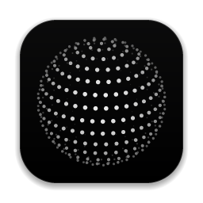
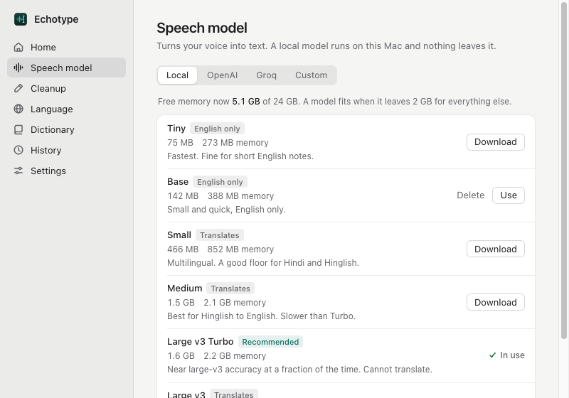

<p align="center">
  
</p>

<h1 align="center">Echotype</h1>

<p align="center">
  Hold a key, speak, let go. Clean text lands wherever your cursor is.<br>
  Free, private, and it runs on the models you choose.
</p>

<p align="center">
  <a href="#set-it-up-with-your-coding-agent">Set up with your agent</a> ·
  <a href="#build-from-source">Build from source</a> ·
  <a href="#shortcuts-and-permissions">Shortcuts and permissions</a>
</p>

<p align="center">
  
</p>

## What it does

- **Dictate into any app.** Hold <kbd>⌥ Space</kbd>, talk, release. Echotype transcribes, cleans up and pastes, then puts your clipboard back.
- **Reads like you typed it.** Filler words go, "four, no wait, five" becomes "5", spoken lists become lists, "new line" starts a new line.
- **Speak Hinglish, get English.** Talk in Hindi, English or both at once; Echotype writes English.
- **A pill that stays out of the way.** A small ball at the bottom of the screen that stays faint until your pointer comes near; drag it anywhere and it snaps to the centre as it passes. When you talk it bursts into a dotted orb that moves with your voice, thinks while it transcribes, and falls back into the ball. Drag it anywhere; it follows the screen you are using, or stays where you put it. Prefer nothing on screen? Use the menu bar icon instead. When nothing can take text, it shows your words in a small card with **Copy** rather than pasting into nowhere.
- **Meeting notes.** Echotype hears your microphone and the computer's audio, writes down who said what and, with a cleanup model set up, sums up decisions and action items. It all runs on your Mac.
- **Drop in a voice note.** Drag an `.opus`, `.m4a`, `.mp3` or `.wav` onto the window for a clean transcript.
- **Any model, both stages.** Local whisper.cpp on your machine, or any OpenAI-compatible endpoint: OpenAI, Groq, OpenRouter, Ollama, LM Studio, or your own server.
- **Knows your machine.** Echotype checks free memory before it loads or recommends a model.
- **A local API for your scripts and agents.** `POST http://127.0.0.1:7811/v1/audio/transcriptions` runs the same pipeline.
- **See how much you talk.** The Stats page shows your words, words per minute and a year grid of the days you dictated. They are counts only, never your text, and stay on your computer; switch them off or clear them on the same page.
- **Two looks.** Classic, or Ink, deep blue ink on warm paper, one click away in Settings. Both follow your light or dark setting.

With local models, nothing leaves your computer. API keys live in the system keychain.

## Speed

15-second clip on an M5 Pro, model already loaded:

| Stage | Model | Time |
|---|---|---|
| Transcription | whisper large-v3-turbo Q5, local | 0.64 s |
| Cleanup | gemma 4 E4B via Ollama | 0.5–0.9 s |

## Set it up with your coding agent

Paste this into Claude Code, Codex, Cursor or any agent that can run commands:

```text
Set up Echotype (https://github.com/Rohilalala/echotype) on this computer.

1. Install what's missing: Rust (rustup), CMake and Node 20+. A Mac needs macOS 13 or later.
   On Linux also install
   libwebkit2gtk-4.1-dev libayatana-appindicator3-dev librsvg2-dev libasound2-dev libxdo-dev clang.
2. Clone the repo, then in app/ run `npm install`, on a Mac `scripts/build-llama-server.sh`,
   and `npm run tauri build`.
3. Install the built app (macOS: copy Echotype.app from
   app/src-tauri/target/release/bundle/macos to /Applications) and open it.
4. Check how much memory is free. In Echotype's Speech model page, download the model it
   marks Recommended. If I want Hindi or Hinglish written as English, also download Medium.
5. Walk me through granting Microphone and Accessibility access. If I want meeting notes,
   also Screen Recording (for the computer's audio). If I want to dictate with the fn key,
   also Input Monitoring, then relaunch Echotype.
6. Prove it works: run Echotype's CLI on a short recording,
   `/Applications/Echotype.app/Contents/MacOS/echotype --transcribe <file>`, and show me the text.

Don't load any local language model unless I ask. If I want cleanup, ask me which provider to use.
```

## Build from source

```sh
git clone https://github.com/Rohilalala/echotype
cd echotype/app
npm install
scripts/build-llama-server.sh    # Mac only: the runner for Echotype's cleanup model
npm run tauri build
```

Needs Rust, CMake and Node 20+, and macOS 13 or later on a Mac. `build-llama-server.sh` builds a pinned llama.cpp release (MIT) into `src-tauri/binaries/`, which the Mac build bundles. Transcribe a file without opening the window:

```sh
echotype --transcribe note.opus
```

## Shortcuts and permissions

| Action | Default | Notes |
|---|---|---|
| Dictate | <kbd>⌥ Space</kbd> | Hold and talk, let go to paste. In toggle mode, press to start and again to finish. |
| Hands-free | Tap the dictation key twice | Keeps recording until you press the key again. |
| Cancel | <kbd>Esc</kbd> | Echotype takes Esc from other apps only while it is recording, hands-free included. |
| Paste last | <kbd>⌘ ⌃ V</kbd> | Pastes your last dictation again. Kept in memory only, so it works with history off. |
| Copy last | <kbd>⌘ ⌃ C</kbd> | Puts your last dictation on the clipboard. |

Every shortcut can be changed in Settings, and paste last and copy last can be turned off. If you upgraded from an earlier version, they start off and Settings offers them once, together with launch at login.

### The pill (macOS)

The orb is [thinking-orbs](https://github.com/Jakubantalik/thinking-orbs) by Jakub Antalik (MIT).

A small ball waits at the bottom of the screen your cursor is on, faint until your pointer comes near it. Click it to dictate hands-free and click again (or ✓) to finish, ✕ cancels. Right-click it for the microphone, language, paste last, history, meeting notes, hide for 1 hour and settings. Turn it off under Settings → Pill, or hide it for an hour from the menu bar; it still shows while you dictate.

Drag the pill anywhere, on any display. Each display remembers where you left it, and a double-click puts it back at the bottom centre. It never goes off-screen or under the menu bar. The pill moves to the screen you are using; turn off **Move to the screen I'm using** to keep it on the screen you last dragged it to.

When nothing focused can take text (the desktop, a list, or Accessibility is off for Echotype), Echotype does not send ⌘V into nowhere. The orb's dots spread out into a small card that says why (Accessibility off, with **Turn on**, or no text field selected) and holds your words, **Copy** and your paste-last shortcut, and closes by itself after 6 seconds; resting the pointer on it holds it open, ✕ or Esc closes it. The text is still your last transcript and in History.

Prefer nothing on screen? Set **Show Echotype in** to **Menu bar** under Settings → Pill. The pill then never shows, not even while you dictate. The menu bar icon becomes the indicator instead: a live waveform while it listens, dots while it transcribes, a brief check when it pastes and a warning sign if something went wrong. Click the icon to dictate hands-free and click again to finish. Right-click it for the microphone, language, paste last, history and settings; its first line says what went wrong, if anything did.

The pill stays out of screenshots and screen sharing unless you turn on **Show pill in screen recordings**. This is best effort: macOS honours it for screenshots and most recorders, but some screen-sharing apps may still capture it.

### Talk key (macOS)

You can also dictate with one key: **fn**, or the left or right **Control**, **Option**, **Command** or **Shift**. Pick it in Settings → Shortcuts. ⌥ Space keeps working alongside it. Hold the key to talk, or tap it twice to go hands-free and tap it once more to finish. It only counts when pressed on its own: pressing another key or clicking while it is down (⌃ + C, ⌘-click, fn + arrow) is your usual shortcut, never a dictation.

To use **fn**, first stop macOS from acting on it: System Settings → Keyboard → **Press 🌐 key to** → **Do Nothing**. This should print `0`:

```sh
defaults read com.apple.HIToolbox AppleFnUsageType
```

### Permissions

- **Microphone**, to hear you while you dictate.
- **Accessibility**, to press ⌘V in the app you're using. Without it, Echotype copies the text and you paste it yourself.
- **Input Monitoring**, only for a talk key. Echotype watches for that one key and whether another key is pressed with it; it never records, stores or logs what you type. After granting it, relaunch Echotype. macOS ties these grants to the app's signature, so a self-built, unsigned Echotype may need them granted again after each rebuild.

## Windows and Linux

Releases include a Windows installer (.msi or .exe, x64 and ARM64) and a Linux .AppImage and .deb. Dictation, local models, cleanup, history, voice notes and the local API work as on a Mac. What differs:

- Dictate with <kbd>Alt Space</kbd> and paste with Ctrl+V; no Accessibility permission is needed. GNOME and KDE use Alt Space themselves, so pick another shortcut in Settings there.
- The pill shows only while you dictate, on the main display. The talk key, the idle pill, menu-bar mode and telling speakers apart are macOS-only.
- On Windows, if Echotype hears nothing, turn on microphone access for desktop apps in Settings → Privacy & security → Microphone. The installers are unsigned, so SmartScreen warns the first time.
- Meeting notes on Windows include the computer's audio, with everyone else labelled Others. On Linux they transcribe your microphone only.
- Linux on Wayland: Echotype runs through XWayland so the pill can float. Apps can't press keys in each other there, so install `wtype` (Sway, Hyprland, KDE) or `ydotool` (any desktop, with `ydotoold` running) to paste; without either, the text stays on the clipboard. The shortcut reaches Echotype only while an X11 app is focused, so bind `echotype --toggle` to a key in your desktop's keyboard settings to dictate anywhere.

## Local models

Echotype picks the models for your Mac by itself (**Automatic**): on a Mac with 8 GB of memory, Small and the smallest Echotype cleanup model, which macOS may page out when it needs the room; with more, Large v3 Turbo Q5 and the 1.5B cleanup model, kept ready. Turn on **Settings → Advanced → Show advanced settings** to choose the models yourself and set how the cleanup model uses memory.

| Model | Download | Memory | Use it for |
|---|---|---|---|
| Large v3 Turbo Q5 | 547 MB | 0.8 GB | The default. Fast and accurate in 99 languages |
| Medium | 1.5 GB | 1.8 GB | Translating Hinglish or any language to English |
| Small | 488 MB | 0.7 GB | Macs with 8 GB of memory; multilingual, also translates |
| Base (English) | 148 MB | 0.4 GB | Low-memory machines |

Turbo models can't translate, so with translation on Echotype switches to a multilingual model you've downloaded.

### Echotype's own cleanup model

A small cleanup model trained for Echotype: Qwen2.5-1.5B-Instruct (Apache-2.0) with a LoRA fine-tune on generated pairs of messy dictation and the text the speaker meant to type, then quantized to a 4-bit GGUF (Q4_K_M). It removes fillers, applies "no wait" corrections, spells your dictionary words and formats spoken lists, all on your Mac.

On the 198 hand-written test cases in `model/eval/handwritten.jsonl`, measured on an M5 Pro:

| | Exact match | Word error rate | Checks passed |
|---|---|---|---|
| Echotype model | 70.7% | 6.5% | 94.9% |
| Same base model, prompted | 7.1% | 42.6% | 35.4% |

It answers in about 100 ms on average and uses about 1.1 GB of memory. Its weak spot is translating Hinglish to English, where it can drop a negation and flip the meaning, so check those results. Style and custom instructions are not used with this model, since it was trained on one short prompt, and it does not write meeting summaries.

It runs inside Echotype: pick **Echotype model (local)** as the cleanup provider and Echotype starts it on your Mac when needed, through a bundled llama.cpp `llama-server` that only Echotype can talk to. There is nothing to install or start.

The weights are not distributed yet, so you train them yourself. From `model/` (needs [uv](https://docs.astral.sh/uv/) and an Apple silicon Mac with about 10 GB of free memory; training took 35 to 56 minutes on an M5 Pro), then quantize with llama.cpp from `app/scripts/build-llama-server.sh`:

```sh
sh train.sh                      # generate data, LoRA train, fuse, evaluate, write out/echotype-clean-f16.gguf
L=../app/src-tauri/target/llama.cpp/build-arm64
cmake --build $L --target llama-quantize
$L/bin/llama-quantize out/echotype-clean-f16.gguf \
  ~/Library/Application\ Support/app.echotype.desktop/models/echotype-clean-q4_k_m.gguf Q4_K_M
```

## Meeting notes

Start meeting notes from the menu bar, the pill's right-click menu or the **Meetings** page. Your microphone is labelled **You**; everyone else is heard through the computer's audio and told apart as Speaker 1, Speaker 2 and so on, which you can rename. The transcript appears as people talk, and when you stop, the configured cleanup model writes a summary with decisions and action items. Without cleanup set up you still get the full transcript. Copy or save any meeting as Markdown or text.

When Zoom, Teams, Google Meet, a Slack huddle, FaceTime or another call app starts using the microphone, Echotype offers to take notes; it only checks which app has the microphone (and a browser's window title), never listens, and records nothing until you click Start. When that call ends it asks to stop them, or stops them by itself if you choose so under Settings → Meetings (macOS 14.2 or later).

Let everyone know before you start. Everything runs on this Mac: the audio of each meeting is kept in Echotype's app data folder under `meetings/`, and delete removes it.

- Computer audio needs **Screen Recording** permission (macOS 13 or later). Echotype records sound only. Without it, only your microphone is transcribed.
- Telling speakers apart uses two small models downloaded with the first meeting: [pyannote segmentation 3.0](https://huggingface.co/pyannote/segmentation-3.0) (6 MB, MIT) and [3D-Speaker ERes2Net](https://modelscope.cn/models/iic/speech_eres2net_sv_en_voxceleb_16k) (26 MB, Apache-2.0), run with [sherpa-onnx](https://github.com/k2-fsa/sherpa-onnx).
- Try it on a recording: `echotype --meeting call.m4a [--speakers 3]` prints a speaker-labelled transcript.

## Local API

Turn it on in Settings, copy the token, then:

```sh
curl http://127.0.0.1:7811/v1/audio/transcriptions \
  -H "Authorization: Bearer $ECHOTYPE_TOKEN" \
  -F file=@note.opus
```

It speaks the OpenAI transcription format, so OpenAI client libraries work if you point their base URL at it. It only listens on 127.0.0.1.

## Echotype Cloud

A hosted option for computers that can't spare the memory may come later. Its server is in [`server/`](server); this version of the app does not offer it.

## Credits

Built on [whisper.cpp](https://github.com/ggml-org/whisper.cpp), [Tauri](https://tauri.app), [sherpa-onnx](https://github.com/k2-fsa/sherpa-onnx) and [screencapturekit-rs](https://github.com/doom-fish/screencapturekit-rs). Hotkey and paste handling borrow from [Handy](https://github.com/cjpais/Handy) (MIT).

## License

MIT
